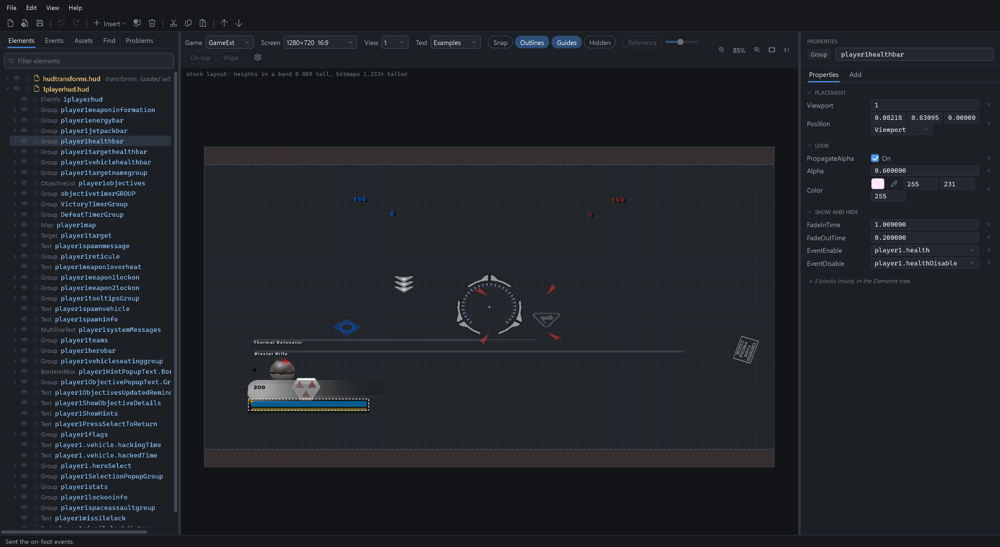

# VisualHUD

An editor for Star Wars Battlefront II (2005) `.hud` files that draws a HUD the way the game
does, on the screen you pick, for the stock game or for the game with
[BF2GameExt](https://github.com/S1thK3nny/BF2GameExt).



The layout follows the engine's own code rather than estimates: positions, Rects and
alignment, the 640 × 480 mapping and the letterbox a wide screen gets, the bitmap stretch,
bar fills, segmented rings, draw order and rounding. How each rule was read is in
[docs/Engine.md](docs/Engine.md), along with what is not modelled yet. What it has of BF2GameExt, and
how it keeps up with it, is in [docs/GameExtParity.md](docs/GameExtParity.md).

## Download

VisualHUD is one file, `VisualHUD.exe`, on the
[Releases page](https://github.com/RJP1992/VisualHUD/releases). It runs on 64-bit Windows 10 or
11 with nothing else to install. It is not signed, so Windows SmartScreen may stop
it the first time: choose **More info**, then **Run anyway**.

On its first start the editor asks where the Battlefront II mod tools are: the `BF2_ModTools`
folder, which it looks for at the root of each drive to start with (picking a folder inside it,
such as `data` or a mod's `data_ABC`, comes to the same). The stock HUD files, textures, models,
fonts and strings are read from there. **File > Mod tools folder** changes it later. Without the
mod tools, a HUD shows what its own folders and the asset folders hold.

**Help > Guide** (F1) walks through the editor, then how a HUD is put together: files, units,
wide screens, events, text and testing in the game. It is also [docs/Guide.md](docs/Guide.md).
The rest of this page is the reference for every feature.

## Build from source

You need the .NET 8 SDK (or newer) on Windows.

```bash
dotnet build SwbfHudEditor.sln
```

Then run `src/SwbfHudEditor.App/bin/Debug/net8.0-windows/VisualHUD.exe`, with one or more
`.hud` files as arguments if you like. Textures, models, fonts, the transforms files and the
English localization are looked up next to the files and in the mod tools, then in any asset
folders you add (see [Assets](#assets)). `tools\publish.bat` builds the release,
`dist\VisualHUD.exe`.

```bash
dotnet test SwbfHudEditor.sln
```

## A HUD's files

A HUD is usually several `.hud` files: the game loads the stock transforms and HUD files, and
a mod can load more. They load additively, into the same screen groups, and each is laid out
by its own `FileInfo`. The editor works on such a set:

- **File > New HUD file** (Ctrl+N) writes a new file with its `FileInfo` and one viewport, in
  the folder you pick, laid out the stock way, with `TrueWidescreen`, or with
  `AuthoredRatio(w, h)`. It opens on its own, or is added to the HUD already open.
- **File > Open** takes one file or several, loaded in name order; **Add HUD file** loads
  more after them; **Remove file from HUD** takes the selection's file out (the file on disk
  is not changed). Several files on the command line load in that order.
- The tree has a node per file, in load order. The transform files the HUD needs load first,
  marked *loaded with the set*: the folder's `hudtransforms.hud` (else the stock one) and its
  other `hudtransforms*.hud`, such as GameExt's.
- Under GameExt, a file with `AuthoredRatio` or `TrueWidescreen` is laid out on its ratio
  while the files without one keep the stock layout, side by side. The tree notes the files
  GameExt lays out; the guides and the layout line are for the selection's file.
- **Edit > Lay out for a screen shape** rewrites the selection's file for `AuthoredRatio(w, h)`
  at a shape you pick (4:3, 5:4, 16:10, 16:9, the two 21:9s, 32:9 or your own) so that on a
  screen of that shape, at the canvas's height, it draws as it does now, whatever laid it out
  before: the stock layout, `TrueWidescreen` or another ratio. Each position becomes where it
  puts its element, and each bitmap's and group's size its size as drawn, through its parents
  as they become, in Viewport (Frame positions stay Frame); a ring of segments keeps its
  middle and its radii, and an element with no `Position` that would move gets one. Text and
  models keep their own shape, which the stock layout squashed, and groups that follow a
  position GameExt tracks, such as the reticule, keep theirs. One undo step.
- Events and transforms reach every file. Each file's checkbox shows or hides its elements.
- **Save** writes every file with unsaved changes, and only those; **Save file as** writes
  the selection's file under a new name. A saved file keeps its comments, blank lines,
  spacing, indentation and line endings: only the lines you edited change.
- Saving first copies the file as it was into `_backups` beside it, as
  `name.hud.yyyyMMdd-HHmmss.bak` (the newest 20 of each file are kept; the `.bak` ending keeps the
  munger off them). If another program changes an open file, the editor asks whether to load it
  again.
- Saving leaves out the lines that only restate the engine's defaults, such as `Alpha(1)`
  or `Rotation(0, 0, 0)`; the Properties panel shows them in grey italics. Lines the game
  needs whatever their value stay: `ZOrder`, a key written twice in a block, anything whose
  default is not known, and any line with a comment before or after it. The list is in
  [docs/Engine.md](docs/Engine.md#defaults).

## Assets

Textures, meshes, fonts and the English localization are looked up in the HUD's own folders
(the `hud` folder and its `Common` folder's `interface`, `effects`, `mshs`, `fonts` and
`Localize`), then in the mod tools' `data\Common`, then in the asset folders.

The strings are the ones the game ends up with: the stock `Localize\english.cfg`, then the PC
build's `Localize\PC\English.cfg` over it, then the mod's own two the same way (for a file in
`data_BF3\Common\hud`, `data_BF3\Common\Localize`), a later file's string replacing an earlier
one's for the same key.

- **Searched automatically:** the data folder of the mod each open file belongs to, with all
  its subfolders (all of `data_BF3`, its `Sides` and `Load` included, for a file in
  `data_BF3\Common\hud`), then the mod tools' own `data`, then their `assets\sides`, where the
  stock weapon models are. A mod's folder needs the mod tools' `<data>\Common\hud` layout; a file
  elsewhere gets none of its own.
- **File > Add asset folder** adds more folders, searched the same way after those, for
  whatever none of them has. A name found in several places resolves to the first path in
  alphabetical order.
- Added folders are remembered in `%LOCALAPPDATA%\VisualHUD\settings.json`. Every folder is
  read in the background, once per session. A large folder (all of `BF2_ModTools` is about
  450,000 files) takes some seconds.
- The **Assets** tab lists what the open files name, where each was found, or that it is
  missing, and what uses it:
  - textures: `Bitmap` and `Mask` lines, and the textures of the models found;
  - meshes: `Mesh`, `MeshInfo`, and the transforms' `NameMesh` rows;
  - fonts: `TextFont`, a `.fff` file;
  - strings: the `Text` keys, missing or with the file their string comes from;
  - the localization files, in the order they lie over each other.
- **Rescan** reads the folders again after files were added to them; the × removes an added
  folder.
- Textures are `.tga` files and models `.msh` files, as the game's munge reads them; a `.png`
  does not count. A font, its `.fff` file, gives text its widths and its glyphs.

## The canvas

- **Game**: *GameExt* honours `AuthoredRatio`, `TrueWidescreen`, `ScreenAnchor` and
  `FillFrom`; *Vanilla* ignores them, as the stock game does, and stretches a HUD on a
  wide screen.
- **Screen**: the resolution the game draws at. With Shader Patch's display scaling that is
  the resolution the game sees (1280×720 on a 4K screen at 150%), and it decides how big a
  `"Pixels"` value is.
- **View**: whose screen group to show.
- **Snap**: the stock draw snaps every element to 1/640 of the width; GameExt's
  `HudSubPixel` (on by default) does not. Switching game resets it.
- **Outlines** marks what draws nothing here: a missing texture, a bitmap without a
  `BitmapRect`, the box of an element the game draws in code.
- **Guides**: the band the stock game squashes the HUD into on a wide screen, or, for a
  file GameExt lays out, the thirds of its layout and where each lands.
- **Hidden** draws faintly what the game's showing and hiding keeps hidden (see
  [Events](#events)).
- The ⚙ button holds **HUD scale**, which resizes `Scalable(1)` elements as the game's video
  option does.
- The elements the game draws in code are drawn as their code lays them out: a BorderedBox's
  frame, an ObjectiveList's objectives, a MultilineText's lines, a VehicleSeating's seats, a
  Target's markers and the Map's backdrop, north pointer, view cone, posts and units, with
  sample objectives, messages, seats, targets, posts and units. A sent `EventChangeMapMode`
  shows the large or spawn map; a sent `EventText` shows in a MultilineText.
- Bitmaps and text blend as the game blends them: `BlendMode("Additive")` adds to what is under
  it, a group's `BlendMode` reaches the children it holds when the line is read, and the Shadow
  style draws the game's black copy at half the alpha, W/554 pixels right and H/554 down.
- Models are drawn as the game draws them, through its camera: one mesh unit is
  `W / (640 × Depth)` pixels across (300 at 1920 wide), a nearer part is larger, and a
  `MeshInfo` places only a mesh its event sends. See [docs/Engine.md](docs/Engine.md#models).
- **Reference** shows an image loaded with **File > Load reference image** (PNG, JPEG, BMP
  or TGA), such as a screenshot or a mock-up, stretched across the screen under the HUD, or
  **On top** of it, at the slider's opacity. **Wipe** draws it over the HUD left of a divider
  you drag across the screen, to check an in-game screenshot edge for edge. It is remembered
  between sessions and never saved into a `.hud` file, so a HUD needs no reference element of
  its own. The guides' lines are drawn over it, wherever it is.
- **File > Export image** saves the HUD as a PNG the size of the **Screen**, as the canvas draws
  it (over the reference image when it shows), without the selection, the guides and the
  outlines.
- The arrow keys move the selection by a screen pixel (Shift: ten) once the canvas has been
  clicked, through each element's last `Position` line in its own unit; a run of them undoes as
  one step. The line above the canvas shows where the mouse is, in screen pixels and in shares of
  the screen.
- Ctrl+wheel zooms at the mouse, Shift+wheel scrolls sideways, and the middle button drags the
  view. The buttons on the right zoom, fit the screen in the view, or show it at one pixel per
  pixel.

## Editing

- **Insert inside** (the Edit menu, or a right-click in the tree) adds a block at the end of the
  selected element or file; **Insert after** adds it right after the selected block. They offer
  every element type the game makes (Group, Bitmap, BitmapMasked, BarBitmap,
  ProceduralBarBitmap, BarSegmented, Text, MultilineText, Model3D, BorderedBox, ObjectiveList,
  VehicleSeating, Map and Target), the seven transforms (GameExt's Math, Lerp and Compare among
  them) and a file's `FileInfo` and `ViewPort`.
- A new block works from the start. An element shows from the start (`EventEnable("initialize")`),
  in the middle of the screen, or at its group's origin inside one. Bars and transforms start on
  the player's health. The map, the targets, the seating chart and the lists come as the stock
  HUD sets them up, templates included.
- What cannot go there is greyed out, and its tooltip says why. Only groups and the elements
  built on one hold elements; transforms go at the top of a file or in a ViewPort; a file has one
  `FileInfo`, at its top. [docs/Engine.md](docs/Engine.md#where-a-block-can-go) has how the game
  reads each.
- **Rename** with F2, a double-click on an element's line in the tree, or the name box at the top
  of the Properties panel. A new block starts with its name selected for typing. The
  `InheritMeshInfo` lines that name a renamed Model3D, and the `TransformNameMesh` lines that
  copy a renamed table, change with it, in one undo step. The status bar points out a name
  another element already has, and an ObjectiveList the game will not fill: it must be named
  `playerNobjectives`. The templates of the map, the targets, the seating chart, a segmented bar
  and a list keep their names, as the game finds them by keyword.
- Dragging an element changes its last `Position` line, in that line's own mode, through the
  inverse of the matrix the game draws it with. Dragging one of several selected elements moves
  them all, in one undo step. An edge or the centre of what is dragged snaps to the edges and
  centres of the other elements drawn and to the screen's edges and centre lines, shown by a
  pink line; hold **Alt** not to snap, and **Shift** to keep to one axis.
- While dragging, orange lines give the gaps in pixels from what is dragged to the nearest
  element facing it on each side, or to the screen's edge. With **Alt** held over an element,
  they give the gaps between it and the element with the cross, or from the one inside to the
  edges of the one round it; over nothing, to the screen's edges. A group with a `Rect` counts as
  its frame, for these and for snapping.
- The element with the cross shows **handles** on its quad, a group's `Rect` or a Text's `TextBox`:
  dragging one resizes it, writing the size in the line's own unit, with its `Position` moved
  so the edges not dragged stay and, for a group, what it holds staying where it is. **Shift**
  keeps its shape; the edges dragged snap as a move does (**Alt** not). One undo step.
- **Arrange** (the Edit menu, and the tree's and the canvas's right-click menus) lines the
  selection up as it is drawn: align left, centres, right, top, middles or bottom (one element
  with the screen, several with the box round them all); space out across or down, with the
  same gap between each (three or more; the outermost two stay); match the width, height or
  size of the element picked last, the one with the cross, for each `BitmapRect` or `Rect`, in
  its own unit. Each is one undo step.
- **Cut**, **Copy** and **Paste** (Ctrl+X, C, V) carry blocks as `.hud` text, so they also go to
  and come from a text editor or another copy of the editor. Pasted blocks go inside the selected
  element when it can hold them, else after it; lines of text paste into the selected block, a
  line it has once replaced. **Duplicate** (Ctrl+D) copies the selection right after itself.
  Copies get names of their own (`name_1`, `name_2`), elements and transforms alike, and so do
  the events an `EventOutput` sends; templates keep theirs.
- **Save as snippet** (the Edit menu and the tree's menu) keeps the selected blocks under a name;
  **Insert saved** (there and in the toolbar's **Insert**) puts one into any HUD as a paste is,
  inside the selection where it fits, renamed where its names are taken. Snippets are `.hud`
  files in a `Snippets` folder beside the editor's settings, which the menu opens.
- **Repeat** (Ctrl+Shift+D) makes copies of the selection in a row, each a step further on the
  screen than the last (the step in pixels, across and down, starting as wide as the selection),
  named as Duplicate names copies; one undo step.
- **Move up** and **Move down** (Alt+Up, Alt+Down) move the selection among its neighbours.
  Dragging rows in the tree moves them before, after or into another row, between files too;
  the marker shows where they will go, and a row that cannot go there is refused with the reason
  in the status bar. Comments move with their block, re-indented. An element moved into another
  group stays where it is drawn: its `Position` is written again for its new parent (with a
  `Scale` for a parent that scales otherwise), and one moved to the top of a file takes the
  viewport it showed in. Hold **Alt** as you drop it to keep its numbers as they are instead.
- **Group** (Ctrl+G, in the Edit menu, and the tree's and the canvas's right-click menus) puts
  the selected elements in a new Group in the place of the first, its `Rect` fitted to them; at
  the top of a file GameExt lays out the group stays a plain container, as a group with a
  `Position` would slide as one piece. **Ungroup** (Ctrl+Shift+G) takes a Group's elements out
  into its place, its `Position` and `Scale` going into theirs; its other lines go with it, and
  the status bar names them. **Fit Rect to contents** makes a plain Group's `Rect` the box round
  what it holds, its `Position` moved so the box's corner is its origin: its frame, the pivot of
  its alignment (Center makes its `Position` the middle of what it holds) and the outline it is
  picked and lined up by. A group GameExt slides keeps its edge with a `ScreenAnchor`. Nothing
  moves on the screen; each is one undo step.
- Each of these, whatever it touches, is one undo step (Ctrl+Z, Ctrl+Y).
- The box above the tree filters it: the rows whose name or keyword contains the text, and the
  rows that hold them.
- **Find and replace** (Ctrl+F, Ctrl+H, or the **Find** tab) looks for text in the arguments of the
  files you opened: element names, events, textures, text keys, and with **Numbers and words**
  numbers and `true`/`false` too, with **Match case** and **Whole value** to narrow it. The
  matches are listed under their elements, the text marked, each with what it becomes; untick the
  ones to leave. **Replace** changes the ticked ones in one undo step. A value that would not
  read back is left as it is: a number stays a number, and a string cannot take a quote. The
  transform files loaded with the HUD are left alone unless you open them. A click on a match
  selects its element, with the Find tab kept in front; a double-click or Enter goes to its box
  in the Properties panel.
- In the Properties panel, a colour is a swatch that opens a picker and shows the change as you
  pick; a mode, an alignment, a style, a font or an event is a list, which takes typing too; an
  on/off line is a switch.
- The eyedropper beside a colour's swatch takes the colour off the canvas with your next click
  there: the reference image's own pixel where it shows (left of a wipe's divider), else the HUD's
  as drawn. It is one undo; Esc lets it go.
- With several elements selected, the Properties panel shows the lines they all have: a value
  they share shows, one they differ in is blank, and a change goes to each of them, the other
  numbers of a line staying each its own. Removing a line, choosing a unit and the **Add** tab work
  on all of them too. Each is one undo step.
- Up and Down step a number, and so does the mouse wheel once the box is clicked (over any other
  box the wheel scrolls the panel): by one for a whole number or a count of pixels, by 0.01 for
  any other fraction; **Shift** ten times as far, **Alt** a hundred times, **Ctrl** a tenth. A
  run of steps on the same numbers is one undo step.
- A number box works out sums: `5.12*2`, `128/4`, `(1920 - 64) / 2`. A number of pixels, as
  `960px`, is put in the line's own unit, so a Viewport position can be typed in pixels. The
  Events tab's value boxes take sums too, and a number there steps the same way, sent at each
  step, to sweep a bar or a fade.
- **Units.** Choosing another unit for a `Position`, `Rect` or `BitmapRect` (Pixels, Screen,
  Viewport, or Frame for a position) converts its numbers, so the element keeps its place and
  size at the canvas's **Screen**. A line written without a unit shows the one the game reads it
  in, greyed, to change the same way. **Edit > Convert units** does it for the selection and
  everything in it, or a whole file, in one undo step: Viewport makes a HUD follow the
  resolution. Choose the resolution the HUD was made for in **Screen** first. A VehicleSeating's
  own `Position` is left as it is, as the game reads it as pixels whatever its unit, and so are
  the `MeshInfo` positions of a table two models read with `InheritMeshInfo`.
- **No pixels.** A number in pixels stays the same number of pixels at every resolution, while
  what is sized in Viewport or Screen units grows and shrinks with the screen, so the two drift
  apart. So nothing the editor works out is written in pixels: a line it writes for a drag, a
  nudge, a resize, Arrange, Repeat, Fit Rect, Fit text box, grouping, ungrouping, a move to another
  parent or **Lay out for a screen shape** goes in Viewport when it was in pixels (Screen and Frame
  are kept), in the same undo step, the element staying where it is at the canvas's **Screen**;
  a `Position` it adds is in Viewport. Only where the game reads pixels whatever is written does
  it keep them (the two lines above). What you type, and a unit you choose, stay as you give them.
- A `TextBox` has a button that fits the box to the text as it shows now (its lines as laid out,
  with a pixel to spare so it wraps as it does), its `Position` moved so the text stays where it
  is; **Edit > Fit text box to text** does the same for the selected Text, adding a `TextBox`
  if it has none. With its text on the baseline, only the width is fitted.
- **Shapes.** A `BitmapRect` has three buttons after its numbers. **Square** sets the height that
  draws it as tall as it is wide on the canvas's **Screen**, whatever stretches it: the stock
  layout's widening (a stock file's square is not written square), GameExt's layout, its groups'
  `Scale`. The second sets the height for the texture's own shape, over the part `TexCoords`
  shows. The lock keeps the drawn shape as the width is changed: the height follows, in the same
  undo step. Each writes the height in the line's own unit.
- The Properties panel's **Add** tab offers every key the game reads for the selected block, by
  the class that reads it (an element's own, its group base, every element's) and GameExt's,
  grouped and with a filter. A template such as `MeshInfo`, `Segment` or a Target template gets
  what its element reads in it, and a Map, Target or VehicleSeating gets back a template it lacks.
  A transform gets its own keys, but not a second source for A or B; another row of its table
  starts as a copy of the last row, right after it.

## Text

Text is laid out as the game lays it out: lines break, wrap and clip in their `TextBox` with
the widths of the game font, read from its `.fff` file, and the box is outlined with the
guides. Each character is the game font's own glyph, with the sixteen levels of coverage the
game's font textures keep. A font that cannot be found is stood in for with a system typeface.

Before any event is simulated, **Text** in the toolbar picks what text elements show:

- **Examples**: the strings of their `Text` keys, with a button in brackets for a `{name}`, and
  for event-driven text what the game would typically send (a weapon name, ammo, a timer as
  `2:05`), numbers printed with the element's own format.
- **Long**: long names, large numbers and paragraphs, to see how a box holds them.
- **Keys**: the keys and event names the file names.

A key the localization lacks shows as the key, as it would in game, and is listed under
**Assets** as a missing string.

## Showing and hiding

What is hidden here is hidden on the canvas only; the files do not change.

- Untick an element in the tree, or press **H**, to hide it and everything in it. A file's tick
  hides its elements.
- **Shift+H**, or a **Ctrl+click** on a tick, shows only that element or file. The other files,
  and every element that neither holds it nor is in it, are hidden; everything in it shows.
- **L**, or the lock beside the eye, locks the selection: a locked element and what it holds (all
  of a locked file's elements) are not picked or dragged on the canvas, so what is under them can
  be, while the tree and the Properties panel still select and edit them. **Alt+L** unlocks
  everything. Like hiding, locking is the editor's: the files do not change.
- **Alt+H** shows everything again. The tree's right-click menu has these under **Show and
  hide**, with **Show everything in this** for one element or file.
- **Ctrl+click** rows to select several, or **Shift+click** to select every row from the last one
  clicked; a Ctrl+click on the canvas adds an element too. H, Shift+H, the **Show and hide**
  menu, a selected row's tick, the Events tab's **Show selected** and Delete then act on all of
  them, Delete in one undo step. The Properties panel, Rename and Insert act on the last one
  clicked, which the canvas marks with a cross.

## Events

The Events tab lists every event the files and their transforms use: what it is (sent by the
game, by GameExt, or by a transform), its type, and who reads it.

- The clock above the list (▶) runs the HUD over time, at 60 frames a second: fades in and
  out, colours easing back and pulsing, `UseChangeColor` flashes, bars' change strips, and
  GameExt's Lerp easing and Compare hysteresis play out as in the game. A send is made at the
  clock's time; drag the slider to see any moment, or ⏮ to play the sends again from 0. At 0 s
  every send shows what it ends with, fades done, so a value can be checked without running time.
- Type a value and press Enter, or **Send** to send it again so it counts as the latest. What it
  sets shows on the canvas at once: bars fill, texts print their numbers and strings, colours,
  textures and models change, and groups move, scale and turn. Transforms run as the game runs
  them, from every file of the HUD in load order.
- Every element keeps showing, but those hidden in the tree, so one event is enough to see what
  it does to the elements you kept in view.
- **Show and hide as the game does** adds the game's rule for what shows: an element shows only
  once its `EventEnable` event has come after its `EventDisable` one, and only while every group
  above it shows. Nothing shows before any event, as in the game. **Show hidden** on the canvas
  then draws what is not enabled faintly, so it can still be picked.
- **Scenarios**: type a name in the box and **Save** to keep the events sent so far, with their
  times on the clock; pick one from the list to send it again in place of what is sent now. They
  are kept in the editor's settings.
- **Initialize** sends `initialize`; **On foot** sends a typical spawned soldier's state and turns
  on the game's showing and hiding; **Show selected** sends whatever shows the selected element;
  **Clear** forgets every event sent.
- Until it is sent, groups that follow the same `EventPosition` event are drawn at one point, the
  written `Position` of the first of them, as the game moves them all to the point it sends.
  Their own `Position` lines only matter until that event arrives. With the game's showing and
  hiding on, a group whose event has not come is where it is written.

The rules are in [docs/Engine.md](docs/Engine.md#events).

## Problems

The **Problems** tab lists what the game reads otherwise than the files you opened seem to say,
under the elements it is in. A click on one selects its element, with the tab kept in front; a
double-click or Enter goes to its line in the Properties panel. It follows every edit.

- **Errors**: what the game makes nothing of (an element in an element that holds none) and a
  `FileInfo` whose `SplitMode` keeps the file from loading.
- **Warnings**: a line or a block the element does not read; a unit that names nothing (a
  `Position`'s reads as Pixels) and a `BitmapRect` with more than five arguments, whose unit is
  not read; a texture, model or font not found; an event that shows an element but that nothing
  sends (not the game, GameExt or a transform in the files loaded; each player's events count);
  `InheritMeshInfo` naming no model made before it, or a table whose positions are not in Pixels
  and are converted again; a `VehicleSeating`'s own `Position` in a unit (it is read as pixels);
  a `Position`, `Rect` or `BitmapRect` in pixels (not 0), which drifts against the rest at
  another resolution, a seating chart's own one included (a group round it can place it in
  Viewport);
  a `Viewport` line inside a group that says otherwise than the group; a group's `BlendMode`
  before its children, which changes nothing; a `MultilineText` without `NumLines`; an
  `ObjectiveList` not named `playerNobjectives`.
- **Notes**, shown with the box ticked: what the game does its own way, often meant. A Target's,
  a MultilineText's or a Map's replaced `Position`, `Rotation`, `Scale` or `TextBox`; a model's
  `Position`, `Rotation` or `Depth` before its `Mesh`; a model's `BlendMode`; a group's
  `BlendMode` between its children; a name another element in the same view has; an event read
  that nothing sends; a transform inside an element; a `FileInfo`'s `Widescreen`; a
  `MeshInfo`'s model not found, which draws only when an event sends it; the pixels of a
  `MeshInfo` table two models read, which must stay so.

## Snapshots

The canvas can be rendered to a PNG without opening a window:

```bash
VisualHUD.exe --snapshot file.hud out.png --screen 1920x1080 --game vanilla
```

Options: `--add other.hud` (repeatable: more files of the HUD, loaded after the first, as in
the editor), `--assets folder` (repeatable: asset folders besides the automatic ones and the
editor's saved ones),
`--screen WxH`, `--game gameext|vanilla`, `--snap on|off`, `--viewport n`,
`--background image.png` (draw over a screenshot of the same size), `--no-placeholders`,
`--no-guides`, `--preset onfoot` and `--send event[=value]` (repeatable, in order) to simulate
events, which show and hide elements as the game does unless `--show all` keeps every element
shown, `--text examples|long|keys`, and `--dump layout.txt` to list every element as laid out.
Errors are written to `out.png.error.txt`.

```bash
VisualHUD.exe --snapshot 1playerhud.hud out.png --preset onfoot --send player1.healthFraction=0.3
```

`--ui-snapshot out.png file.hud...` draws the whole editor window instead, off the screen, with
`--ui-size WxH`, `--ui-select name`, `--ui-left elements|events|assets|find|problems` and
`--ui-preset onfoot`, to check the interface without showing it. It waits for the asset folders to
be read first. The picture at the top of this page is
`--ui-snapshot visualhud.png 1playerhud.hud --ui-size 1920x1080 --ui-preset onfoot --ui-select player1healthbar`.

## Credits

VisualHUD is made by Ryan Hank with the help of Claude, built on the original, unfinished tool by
Surestsafe, which gave it its `.hud` parser and writer, mesh and texture loading, localization,
undo and the property panel.
